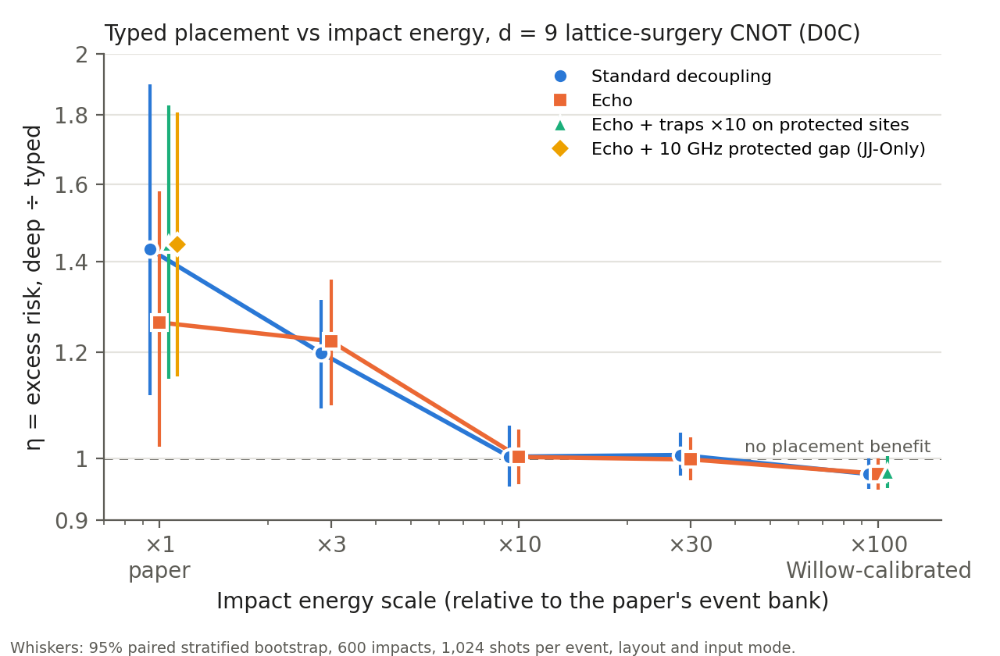

# PACER calibration extension: completed run
8 November 2026

**Main result:** Typed placement lowers burst risk relative to the deep type-blind band only for small impacts. At the paper's energy scale (×1), the deep-to-typed excess-risk ratio is **η = 1.43** [1.11, 1.90]. At ×3 it is 1.20 [1.09, 1.31]. From ×10 upward, which is about where Willow's 200 kHz detector starts to see events, η is indistinguishable from 1. At Willow-calibrated impacts (×100), it is 0.97 [0.95, 1.00]. Echoed decoupling, ten times faster trapping on protected sites, and a 10 GHz protected gap leave this picture unchanged. Intervals are nominal 95% paired-bootstrap intervals.

## What was tested
The paper's runs held three model choices fixed. This study varies each of them on the paper's own 600-impact bank (seed 78001), using the same three Fig. 2a layouts: shallow `d8ba0ac6af1b5bce`, deep `1603afb01c8bb608`, typed `feb78d5b7189d641`.

1. **Impact energy scale.** The paper's events use energies of 0.01 × the configuration range on which the phonon generation scale was calibrated to Willow (Kurilovich et al., median 2 MHz peak shift). Delivered dose is multiplied by ×1, ×3, ×10, ×30 or ×100. ×1 is the paper; ×100 is the calibration scale.
2. **Decoupling.** "Standard" is Willow's unechoed circuit (i), used in every paper run. "Echo" is circuit (iii), via the bridge's frozen power-law echo residual.
3. **Protection type.** Two variants, both under echo: trapping on protected ancillas and data qubits × 10 (a stand-in for an M1-style gap step), and the protected-ancilla gap reduced from 12 to 10 GHz (Pinckney JJ-Only δΔ_JJ). Both are hybrids on a Willow-like device, not MIT device models.

Peak frequency shift of the bank on an all-12 GHz device, weighted by the population:

| Scale | Median peak | 90th percentile | Median sites above 200 kHz |
|---|---:|---:|---:|
| ×1 | 19 kHz | 87 kHz | 0 |
| ×3 | 58 kHz | 260 kHz | 0 |
| ×10 | 192 kHz | 852 kHz | 0 |
| ×30 | 571 kHz | 2.46 MHz | 6 |
| ×100 | 1.84 MHz | 7.42 MHz | 21 |

## Results
Excess risk is the impact-conditioned increase in any-output failure over quiet operation, taking the worse input mode, under correlated background matching (D0C). η = R(deep) / R(typed).

| Scale | Decoupling | Variant | Shallow | Deep | Typed | η (deep ÷ typed) | Shallow ÷ typed |
|---|---|---|---:|---:|---:|---|---|
| ×1 | standard | — | 7.52e-4 | 4.31e-4 | 3.01e-4 | **1.43 [1.11, 1.90]** | **2.50 [1.58, 3.92]** |
| ×1 | echo | — | 7.46e-4 | 4.44e-4 | 3.52e-4 | **1.26 [1.02, 1.58]** | **2.12 [1.35, 3.23]** |
| ×3 | standard | — | 8.31e-3 | 6.86e-3 | 5.73e-3 | **1.20 [1.09, 1.31]** | **1.45 [1.22, 1.87]** |
| ×3 | echo | — | 8.23e-3 | 6.94e-3 | 5.68e-3 | **1.22 [1.10, 1.36]** | **1.45 [1.22, 1.88]** |
| ×10 | standard | — | 5.53e-2 | 4.77e-2 | 4.76e-2 | 1.00 [0.95, 1.06] | **1.16 [1.01, 1.47]** |
| ×10 | echo | — | 5.49e-2 | 4.75e-2 | 4.74e-2 | 1.00 [0.96, 1.05] | **1.16 [1.03, 1.46]** |
| ×30 | standard | — | 1.37e-1 | 1.33e-1 | 1.32e-1 | 1.01 [0.97, 1.04] | **1.04 [1.01, 1.22]** |
| ×30 | echo | — | 1.37e-1 | 1.32e-1 | 1.32e-1 | 1.00 [0.96, 1.04] | **1.04 [1.01, 1.23]** |
| ×100 | standard | — | 2.63e-1 | 2.53e-1 | 2.60e-1 | 0.97 [0.95, 1.00] | 1.01 [1.00, 1.11] |
| ×100 | echo | — | 2.61e-1 | 2.53e-1 | 2.60e-1 | 0.97 [0.95, 1.00] | 1.01 [0.99, 1.10] |
| ×1 | echo | traps × 10 | 7.21e-4 | 4.26e-4 | 2.95e-4 | **1.44 [1.15, 1.83]** | **2.44 [1.52, 3.80]** |
| ×100 | echo | traps × 10 | 2.60e-1 | 2.51e-1 | 2.57e-1 | 0.98 [0.95, 1.00] | 1.01 [1.00, 1.11] |
| ×1 | echo | 10 GHz gap | 8.05e-4 | 5.21e-4 | 3.61e-4 | **1.44 [1.15, 1.81]** | **2.23 [1.46, 3.33]** |

Bold: the 95% interval excludes 1. At ×100 the upper η limits are 1.0002 (standard), 1.0006 (echo) and 1.004 (traps), so none is resolved below 1. At ×100 the shallow-to-typed lower limits are 0.997, 0.993 and 0.996.

## Reading against the pre-registered rules
- **Anchor (regression), passed.** At ×1 standard, the regenerated typed (3.01e-4) and shallow (7.52e-4) risks lie inside the count sweep's intervals. The paired new-minus-old intervals contain 0: typed [−0.27, +1.46]e-4, shallow [−0.91, +0.80]e-4. The count sweep ran on macOS arm64, and seeded Stim samples differ across machines, so bit-identity was not required.
- **η > 1 resolved at ×100 with echo: no.** The strongest claim is not supported.
- **η > 1 at small scales, not at ×100: yes, and the cut-off is lower than ×10.** η is resolved at ×1 and ×3 only. The paper's typed-versus-deep advantage applies to impacts whose median peak shift is below about 60 kHz, under Willow's detection threshold. The claim must be restricted to these sub-threshold events and argued from their rate.
- **Standard vs echo: no difference at any scale.** The ×1 point estimates differ (1.43 vs 1.26), but the intervals overlap almost entirely and the ×3 to ×100 points coincide. This matches the Step 5 channel check: summed over the burst, ancilla Pauli mass under echo is only 6% lower even at ×100, because relaxation, excitation and readout dominate the summed channel.
- **Trap × 10 and the 10 GHz gap: no sharp change.** Both intervals contain the matching echo point estimate, at ×1 and at ×100. In this model, faster trapping on protected sites does not interact with placement.
- **Typed vs shallow persists longer.** The typed band beats the shallow band, with the interval excluding 1, up to ×30. It is unresolved at ×100.

## Interpretation and limits
- Above ×10, every layout has an excess risk of 5% to 26% per impact. Bursts of this size overwhelm the CNOT whatever the layout. At ×100, 42% of Step 5 control tasks failed on at least half their shots, pooled over deep and typed (random output = 0.75). The ×100 ratio is compressed toward 1 and does not show that placement is irrelevant in a less saturated circuit, for example at larger distance.
- Descriptive, not pre-registered: the absolute deep-minus-typed risk difference is about 1.3e-4 at ×1 and 1.1e-3 at ×3. The largest absolute saving is therefore at ×3 (median peak about 58 kHz).
- This is a post hoc extension on the paper's 600-impact bank, not an independent impact cohort. All 13 settings share events and trajectory seeds (common random numbers), and intervals are nominal.
- The strata were defined on ×1 dose. Uniform scaling keeps the strata and weights valid but not variance-optimal at high scale.
- The quiet baseline is unchanged; decoupling and traps act only on burst channels in this model. The trap-prior recovery-class consistency check failed in calibration (0.86–13 ms), and the trap × 10 variant departs from that prior on purpose.

## Design
- d = 9 L-shaped lattice-surgery CNOT; 12 pre-rounds, 9-round ZZ merge, 9-round gap, 9-round XX merge, 12 post-rounds. SI1000 p = 1e-3; weak/strong gaps 5/12 GHz; κ = 0.5; frozen bridge draw v2_energy_resolved_cutoff / lhs_000 (generation_scale 58.49, trapping 245.1 s⁻¹).
- 13 physics settings × 3 layouts × 600 impacts × 2 input modes = 46,800 tasks at 1,024 shots, D0C only, trajectory seed base 78002. All 11,700 blocks completed with no failures.
- Run order: anchor (A0), then waves A, B and C with no interim looks; one joint analysis. Protocol frozen before any campaign trajectory (`FROZEN_PROTOCOL.json`).
- Runtime: Windows 11, Python 3.13.12, NumPy 2.5.2, Stim 1.16.0, PyMatching 2.4.0. No NumPy pin was needed: the local `nonmarkov.py` already falls back to `np.trapezoid`. The `claude/ms3-r9-estdecoder` branch tip (7b4c6ba) still evaluates `np.trapz` eagerly and fails on NumPy 2.x.

## Files
- `per_event_counts.csv.gz`: per (condition, input mode, event) D0C histograms. Condition = `<layout>|E<scale>|<decoupling>|T<trap multiplier>|G<protected gap GHz>`.
- `RESULTS.json` (all settings), `ANCHOR.json`, `STEP5_CHECKS.json`, `STEP5_TIMING.json`, `FROZEN_PROTOCOL.json`, `study_calext_*.json`.
- `recompute_results.py`: standalone check (Python and NumPy) that reproduces every η and its interval from the per-event counts.
- `eta_vs_energy.png` / `.pdf`: the figure above.
- `analysis_source/`: run, analysis and export scripts, plus the modified `pacer_continuous.py` (adds the `decoupling` argument; its default reproduces the old channels bit for bit).
